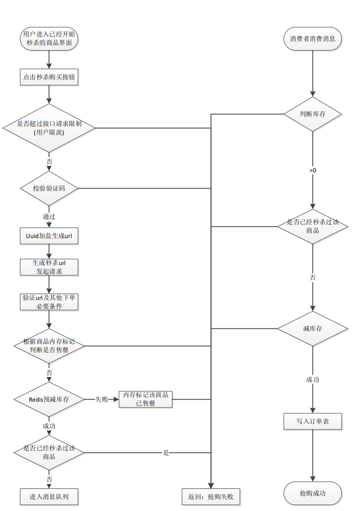

# High-Concurrency Flash Sale System (Spring Boot + Redis)


An optimized flash sale system designed to handle high concurrency using **Spring Boot** and **Redis**.  
This project focuses on preventing common issues in flash sale (seckill) scenarios such as overselling, traffic spikes, and cache inconsistency.

---

## Table of Contents

- [Overview](#overview)
- [System Workflow](#system-workflow)
- [Dynamic URL Path & Signature](#dynamic-url-path--signature)
- [Static Resource Optimization](#static-resource-optimization)
- [Verification Code](#verification-code)
- [Inventory Preheating](#inventory-preheating)
- [Overselling Problem](#overselling-problem)
- [Rate Limiting](#rate-limiting)
    - [Leaky Bucket Algorithm](#leaky-bucket-algorithm)
    - [Token Bucket Algorithm](#token-bucket-algorithm)
    - [Distributed Rate Limiting (Redis + Lua)](#distributed-rate-limiting-redis--lua)
- [User Request Frequency Control](#user-request-frequency-control)
- [Cache–Database Consistency](#cache–database-consistency)
    - [Why Not Update Cache Directly](#why-not-update-cache-directly)
    - [Why Not Delete Cache Before DB Update](#why-not-delete-cache-before-db-update)
    - [Update DB Then Delete Cache](#update-db-then-delete-cache)
    - [Delayed Double Deletion](#delayed-double-deletion)
- [Cache Key Design Pattern](#cache-key-design-pattern)

---

## Overview

This project demonstrates a high-performance flash sale (seckill) backend system architecture.
It integrates **Spring Boot**, **Redis**, and **MySQL**, and is designed to handle millions of concurrent requests through caching, rate limiting, and distributed locking strategies.

---

## System Workflow



1. User requests a dynamic path.
2. Backend verifies user and path validity.
3. Verification code is checked to prevent bots.
4. Redis manages inventory and reduces database access.
5. Order creation is processed asynchronously.

---

## Dynamic URL Path & Signature

To prevent direct interface exposure and malicious requests, URLs are dynamically generated and encrypted using **MD5 with salt**.

```java
@RequestMapping(value = "{path}/do_miaosha")
@ResponseBody
public ResultSk<Integer> miaosha(Model model, SkUser skUser,
    @RequestParam("goodsId") long goodsId,
    @PathVariable("path") String path) {
    // Validate path
    boolean check = skService.checkPath(skUser, goodsId, path);
    if (!check) {
        result.withError(REQUEST_ILLEGAL.getCode(), REQUEST_ILLEGAL.getMessage());
        return result;
    }
    ...
}

@AccessLimit(seconds = 5, maxCount = 5, needLogin = true)
@RequestMapping(value = "path")
@ResponseBody
public ResultSk<String> skPath(Model model, SkUser skUser,
    @RequestParam("goodsId") long goodsId,
    @RequestParam(value = "verifyCode", defaultValue = "0") int verifyCode) {
    ResultSk<String> result = ResultSk.build();
    model.addAttribute("user", skUser);
    if (skUser == null) {
        result.withError(ResultStatus.SESSION_ERROR.getCode(), ResultStatus.SESSION_ERROR.getMessage());
        return result;
    }
    boolean check = skService.checkVerifyCode(skUser, goodsId, verifyCode);
    if (!check) {
        result.withError(REQUEST_ILLEGAL.getCode(), REQUEST_ILLEGAL.getMessage());
        return result;
    }
    String path = skService.createSkPath(skUser, goodsId);
    result.setData(path);
    return result;
}

@Override
public String createSkPath(SkUser skUser, long goodsId) {
    // Generate URL
    String str = MD5Util.md5(UUIDUtil.generateUuid() + "123456");
    // save it in cache
    redisService.set(SkKey.getSkPath, "" + skUser.getId() + "_" + goodsId, str);
    return str;
}
```

Clients first request /path to obtain a signed URL, then call {path}/do_miaosha to execute the seckill.

---

## Static Resource Optimization

All static resources (HTML, JS, CSS, etc.) are uploaded to a **CDN** in advance.  
This reduces backend load during high-concurrency moments since pages are served directly from the CDN.

---

## Verification Code

Verification codes or sliders are introduced before the flash sale begins to filter out automated requests and bots.

---

## Inventory Preheating

Inventory data is **preloaded into Redis** before the sale starts using scheduled jobs.  
All inventory checks and deductions occur in Redis to improve speed and reduce DB contention.

---

## Overselling Problem

**Cause:** When multiple servers check and deduct stock simultaneously, inventory may go negative.

**Solution:**  
Use **optimistic locking (CAS)** in MySQL or atomic Lua scripts in Redis.

```mysql
SELECT version FROM goods WHERE id = 1001;
UPDATE goods SET num = num - 1, version = version + 1 WHERE id = 1001 AND num > 0 AND version = @version;
```

**Redis Optimization:**  
Use a Lua script to ensure stock validation and deduction happen atomically.

---

## Rate Limiting

### Leaky Bucket Algorithm

Incoming requests (water) enter a bucket and leak at a fixed rate.  
If the bucket is full, additional requests are dropped — ensuring a **constant request rate**.

### Token Bucket Algorithm

Allows a steady rate but permits short bursts.  
Tokens are added to the bucket at a fixed rate, and each request consumes a token.

### Distributed Rate Limiting (Redis + Lua)

Redis executes Lua scripts atomically to manage request frequency across distributed nodes.

```java
String lua =
    "local key = KEYS[1] " +
    "local limit = tonumber(ARGV[1]) " +
    "local current = tonumber(redis.call('get', key) or '0')" +
    "if current + 1 > limit then return 0 " +
    "else redis.call('INCRBY', key,'1') redis.call('expire', key,'10') end return 1";
```

This ensures atomicity and thread safety in a distributed environment.

---

## User Request Frequency Control

Each user’s request frequency is limited using an **Interceptor**.  
See [AccessLimit.md](seckill-system-springboot/doc/AccessLimit.md) for details.

---

## Cache–Database Consistency

**Read:** Read from cache first. If not found, query DB and write to cache.  
**Update:** Update DB first, then delete cache.

### Why Not Update Cache Directly

- High write frequency may lead to performance waste and stale data.
- Race conditions may result in **dirty cache** (e.g., A updates DB → B updates DB → B updates cache → A updates cache).

### Why Not Delete Cache Before DB Update

Deleting cache first may cause a short window where other requests query old data and repopulate stale cache before DB updates finish.

### Update DB Then Delete Cache

This is generally safe, since **read operations are faster than write operations** — making stale data unlikely.

### Delayed Double Deletion

1. Delete cache.
2. Update database.
3. Wait ~1 second, then delete cache again.

This ensures cache is clean after all concurrent reads complete.

---

## Cache Key Design Pattern

The **Template Pattern** is used for cache key design.

**Advantages:**
- Defines overall algorithm structure, allowing flexible extension.
- Promotes code reuse and maintainability.
- Follows the *Open–Closed Principle*.

**Disadvantages:**
- Each implementation requires a subclass, possibly increasing class count.

---

## Tech Stack

- **Backend:** Spring Boot, MyBatis, Redis, MySQL
- **Cache:** Redis (atomic Lua scripts, preheating, consistency strategies)
- **Concurrency Control:** Lua scripts, optimistic locks, distributed limiters
- **Security:** Dynamic path encryption, verification codes, access limits
